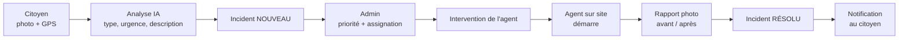
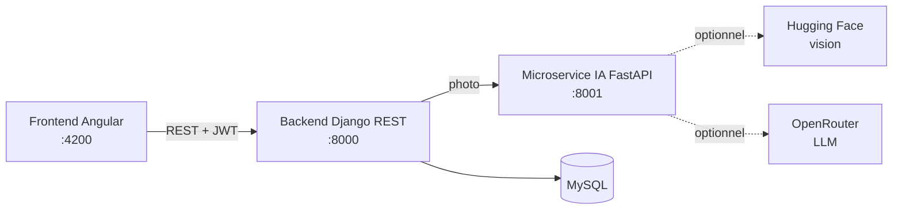

# Andë Sétal — Présentation du projet

> *Andë Sétal* : « ensemble, rendons propre » en wolof.

## Le problème

À Dakar-Plateau, les dépôts sauvages d'ordures, les caniveaux bouchés, les nids-de-poule ou les lampadaires en panne sont souvent signalés tard, par téléphone ou pas du tout. La mairie manque d'une vue d'ensemble pour prioriser les interventions, et les citoyens ne savent pas si leur signalement a été pris en compte.

## La solution

Une plateforme de **co-gestion de la salubrité urbaine** qui relie trois acteurs :

| Acteur | Ce qu'il fait dans Andë Sétal |
|---|---|
| **Citoyen** (app mobile) | Prend une photo d'un problème, l'envoie avec sa position GPS, suit l'avancement de ses signalements et reçoit une notification quand c'est résolu. |
| **Administrateur de la mairie** (dashboard web) | Voit tous les incidents sur une carte et dans des statistiques, fixe la priorité et assigne un agent de terrain. Gère l'équipe d'agents et leurs performances. |
| **Agent de terrain** (app mobile) | Reçoit ses interventions classées par urgence, démarre sur site, envoie un rapport avec photo avant / après, ce qui clôture l'incident. |

Une **intelligence artificielle** analyse chaque photo envoyée : elle propose un type d'incident et un niveau d'urgence, rédige une description et des recommandations d'intervention en s'appuyant sur les règles de salubrité de Dakar.

## Le parcours d'un signalement

À chaque étape, le citoyen est notifié (prise en charge, puis résolution) et les indicateurs du dashboard se mettent à jour : incidents par type, évolution sur 30 jours, taux de complétion et ponctualité de chaque agent (calculée par rapport à un délai cible selon l'urgence : 24 h pour un incident critique, 48 h élevé, 72 h modéré, 7 jours en routine).

## Fonctionnalités principales

**Citoyen**
- Inscription par email ou téléphone avec vérification par code OTP
- Signalement photo (caméra ou galerie) géolocalisé, limité au périmètre de Dakar-Plateau
- Historique et détail de ses signalements, carte des incidents du quartier
- Profil modifiable, prochain événement de nettoyage citoyen (Set-Setal)

**Administrateur**
- Tableau de bord : indicateurs clés, évolution sur 30 jours, répartition par type, classement des agents
- Carte de tous les incidents géolocalisés
- Gestion des incidents : priorité, notes internes, assignation à un agent
- Gestion des agents : création, fiche détaillée (activité de la semaine, spécialisation, historique)

**Agent**
- Accueil avec l'intervention prioritaire et ses indicateurs
- Liste des interventions (filtres urgences / proximité), carte de ses interventions
- Détail d'intervention : démarrage sur site, rapport photo avant / après
- Historique du rapport, profil et disponibilité

## Architecture

| Brique | Technologies |
|---|---|
| Frontend | Angular 22, Tailwind CSS, Leaflet (cartes), Chart.js |
| Backend | Python 3.12, Django 6.1, Django REST Framework, JWT, MySQL 8 |
| IA | FastAPI, Hugging Face (vision), base de règles RAG, OpenRouter (LLM) |
| Exécution | Docker Compose (4 conteneurs : base, backend, IA, frontend) |

Le microservice IA fonctionne aussi **sans clé API** grâce à un mode dégradé local : la plateforme reste utilisable, l'analyse est alors moins précise et marquée d'une confiance faible (le type choisi par le citoyen est conservé).

## Équipe

_à compléter (noms et rôles)_
