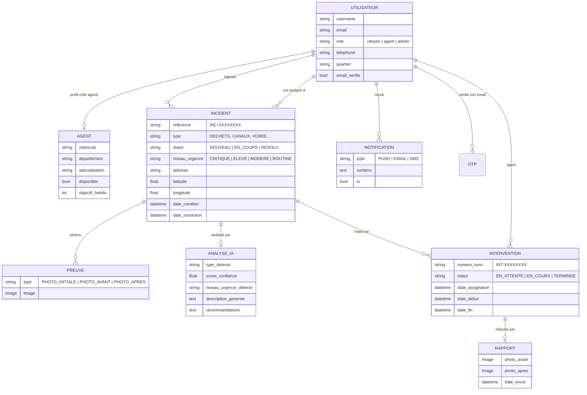

# Andë Sétal — Base de données

Base **MySQL 8** gérée par l'ORM Django. Le schéma est entièrement décrit par les **migrations Django**, versionnées dans le dépôt backend. Une commande de peuplement fournit un jeu de données de démonstration cohérent.

## Modèle de données



Également : `JournalActivite` (traçabilité des actions) et `EvenementSetSetal` (journées citoyennes de nettoyage annoncées sur l'accueil citoyen).

## Scripts de migration

| Application | Migrations |
|---|---|
| `users` | `0001_initial` |
| `incidents` | `0001_initial`, `0002_preuve_image_field`, `0003_incident_date_resolution` |
| `interventions` | `0001_initial`, `0002_remove_rapport_contenu_pdf_and_more`, `0003_intervention_date_assignation` |
| `notifications` | `0001_initial` |
| `dashboard` | `0001_initial` |

Application des migrations :

```bash
# Avec Docker (depuis Backend_AndeSetale/) : appliquées automatiquement au démarrage du backend
docker compose -f deploy/docker-compose.yml up -d

# Sans Docker
cd Backend_AndeSetale
uv run python manage.py migrate
```

## Peuplement (données de démonstration)

```bash
# Avec Docker (depuis Backend_AndeSetale/)
docker compose -f deploy/docker-compose.yml exec backend python manage.py peupler_demo

# Sans Docker
uv run python manage.py peupler_demo

# Recréer les données de démonstration à neuf
python manage.py peupler_demo --reset
```

La commande crée :

| Données | Quantité | Détail |
|---|---|---|
| Administrateur | 1 | `admin@demo.andesetal.sn` |
| Agents | 5 | un par spécialité (déchets, canaux, voirie, éclairage, espaces verts) |
| Citoyens | 8 | comptes vérifiés, quartier Plateau |
| Incidents | 40 | répartis sur 30 jours, positions réelles dans le périmètre de Dakar-Plateau, tous types et niveaux d'urgence |
| Interventions | ≈ 30 | en attente, en cours ou terminées, créées par le vrai workflow métier |
| Notifications | ≈ 80 | générées automatiquement par le workflow |
| Événements Set-Setal | 2 | à venir |

**Mot de passe de tous les comptes de démonstration : `Demo2026!`**

Comptes conseillés pour une démonstration :

| Rôle | Identifiant | Page de connexion |
|---|---|---|
| Administrateur | `admin@demo.andesetal.sn` | http://localhost:4200/dash/connexion |
| Agent | affiché en fin de commande (l'agent ayant le plus d'interventions à démarrer) | http://localhost:4200/connexion |
| Citoyen | `awa.diallo@demo.andesetal.sn` | http://localhost:4200/connexion |

Garanties :
- **Reproductible** : les données sont générées avec une graine fixe.
- **Isolée** : seuls les comptes en `@demo.andesetal.sn` (et leurs incidents) sont créés ou supprimés ; les autres données de la base ne sont jamais touchées.
- **Cohérente** : chaque incident assigné possède son intervention, chaque incident résolu son rapport et sa date de résolution, ce qui alimente les statistiques du dashboard et des agents.

Les incidents de démonstration n'ont pas de photo : pour montrer l'analyse IA, créer un signalement avec photo depuis l'application citoyen.
